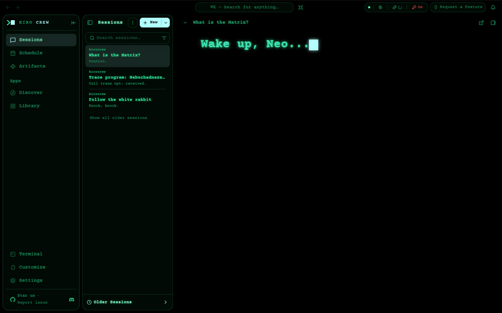
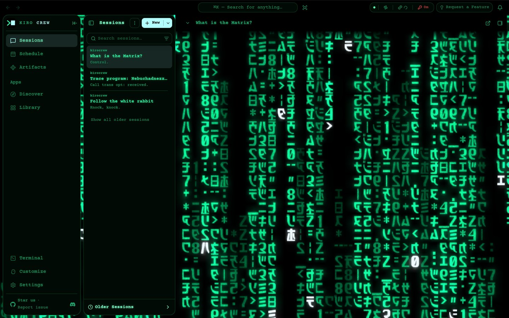

# Kiro Crew theme: Matrix

An unofficial [Kiro Crew](https://github.com/kirodotdev/KiroCrew) theme pack modeled on the computer screens in *The Matrix* (1999).

| Repo | What it is |
|---|---|
| This one | The full pack (Level 2): colors, fonts, cursor, and the idle screensaver |
| [kirocrew-theme-matrix-quiet](https://github.com/leozhad/kirocrew-theme-matrix-quiet) | The same pack without the screensaver (Level 1) |

| Part | What it does |
|---|---|
| Dark mode | Neo's terminal: black CRT, green phosphor text with glow, Courier type, the film's block cursor color, code blocks in one green |
| Light mode | The Construct (the white loading program): neutral white with green ink |
| Thinking indicator | A blinking block cursor |
| Screensaver | After 15 min with no key press or click, it types "Wake up, Neo...", "The Matrix has you...", "Follow the white rabbit.", then shows "Knock, knock, Neo." and starts the digital rain. Press Shift or click to dismiss. The click does not reach the app. It sleeps after 30 min. |

## Screenshots

| Dark mode | Light mode |
|---|---|
|  |  |

| Screensaver: the wake-up message | Screensaver: the digital rain |
|---|---|
|  |  |

## Install

1. Open Settings → Display → Theme.
2. Under **Install Theme**, choose **GitHub** and paste `https://github.com/leozhad/kirocrew-theme-matrix`.
3. Install, then pick **💊 Matrix** in the Theme list.

For the version without the screensaver, use `https://github.com/leozhad/kirocrew-theme-matrix-quiet` instead.

Choosing the full pack turns the screensaver on without asking. It does not run when the OS is set to reduce motion.

Courier Prime feeds both the Sans and Mono font roles. To keep your OS font, pick System under Settings → Display → Font Family.

To update, install the same URL again.

## How close it is to the film

Every film number was measured from 4K UHD frames, using the median of lit pixels. The 4K UHD color timing is close to the 1999 theatrical release. The 2008 Blu-ray added a stronger green tint.

| Element | Film | Theme |
|---|---|---|
| Terminal text hue | 146°–161° across four frames | `#33e59a`, 154° |
| Block cursor | `#B2FFFE`, 1.17:1 tall (opening frame) | same color and shape |
| Rain glyph ink, at 1280 px wide | 20 × 28 px | 20 × 28 px |
| Rain row pitch | 34 px | 34 px |
| Rain screen area lit | 20.7%–24.7% | 22%–24% |
| White lead glyphs, share of lit area | 1.7%–1.8% | 1.6%–2.5% |
| Rain hue | 154° | 155° |
| Lead glyph | cool white, `#EBF6FB` | `#ECF8FD` |
| Typeface | Courier-style slab mono | Courier Prime |

The rain follows the film's rules as documented by [Rezmason/matrix](https://github.com/Rezmason/matrix):

- Glyphs sit in a fixed grid and never move. A drop is a wave of light passing down a column.
- Drops in one column never collide.
- Some drop heads flare white. Glyphs flicker. Everything glows, with a faint green haze between columns.
- The glyphs are mirrored katakana, digits and symbols, plus the dot, underscore and dakuten forms seen in the film.

## Where it departs from the film

- **Status colors.** The film's screens use one color, but the UI needs status colors. `--danger` is red-pill red, `--info` is blue-pill blue, `--warn` is amber.
- **Body weight.** Body text uses Courier Prime Regular so that bold emphasis still shows. The film's single-weight terminal text is closer to Bold, which the screensaver uses.
- **Light-mode code.** Code keeps its syntax colors. A one-green filter on white drops token contrast to 2.4:1.

## What a pack cannot change

- **Panels.** The nav rail, session list, chat header and top bar paint above theme overlays, so the screensaver shows only behind the chat area. Thin slivers of rain show in the gaps between panels.
- **Fixed colors.** The Settings section icon tiles and the glass search bar keep fixed colors.
- **Consent.** Choosing the full pack starts the screensaver without asking, because the dashboard asks only for packs with audio or a persona. Use the quiet pack to skip it.
- **Idle timer.** Only key presses and clicks reset the timer. Scrolling and keys typed in the built-in Terminal do not.
- **Reduced motion.** The screensaver does not run when the OS asks for reduced motion. The thinking cursor still blinks, because browsers do not pass that setting to SVG images.

## Credits and licenses

See [`LICENSE.txt`](LICENSE.txt):

- The pack is MIT.
- Rezmason's `Matrix-Code.ttf` glyph art, embedded in `overlays/rain.html`, is MIT. He recovered the glyph shapes from an official promo SWF, and Warner Bros. may hold rights in that original art.
- Courier Prime is under SIL OFL 1.1.

"The Matrix" is a trademark of Warner Bros. This fan theme has no affiliation with Warner Bros.
