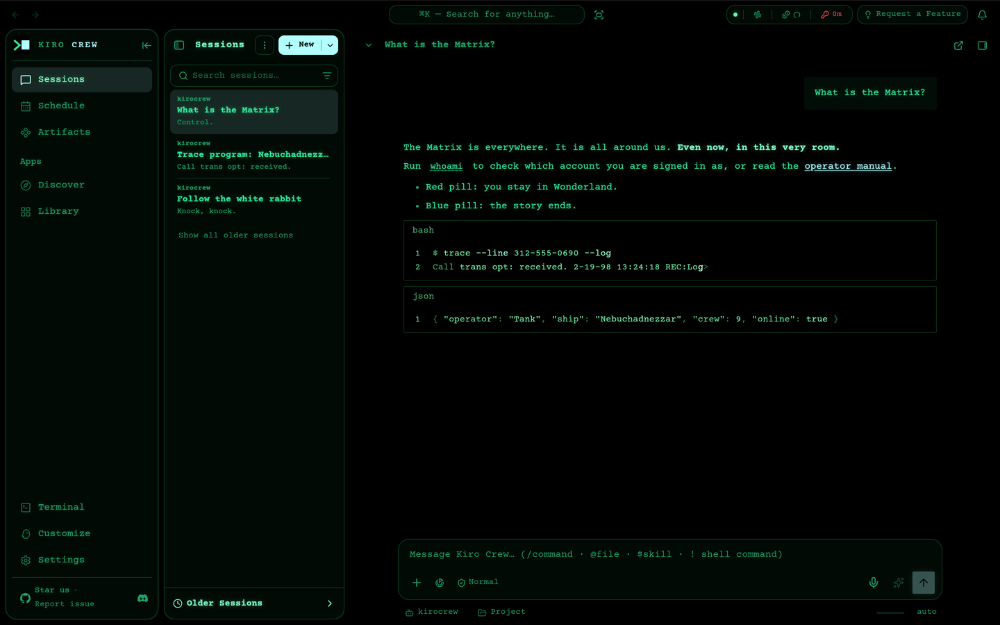
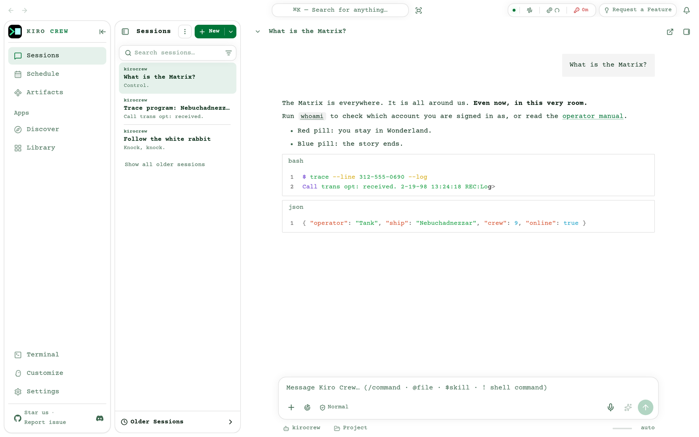
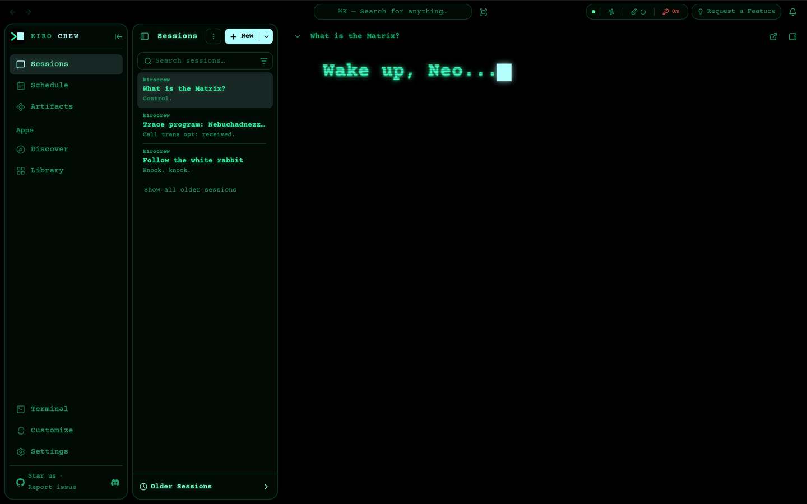
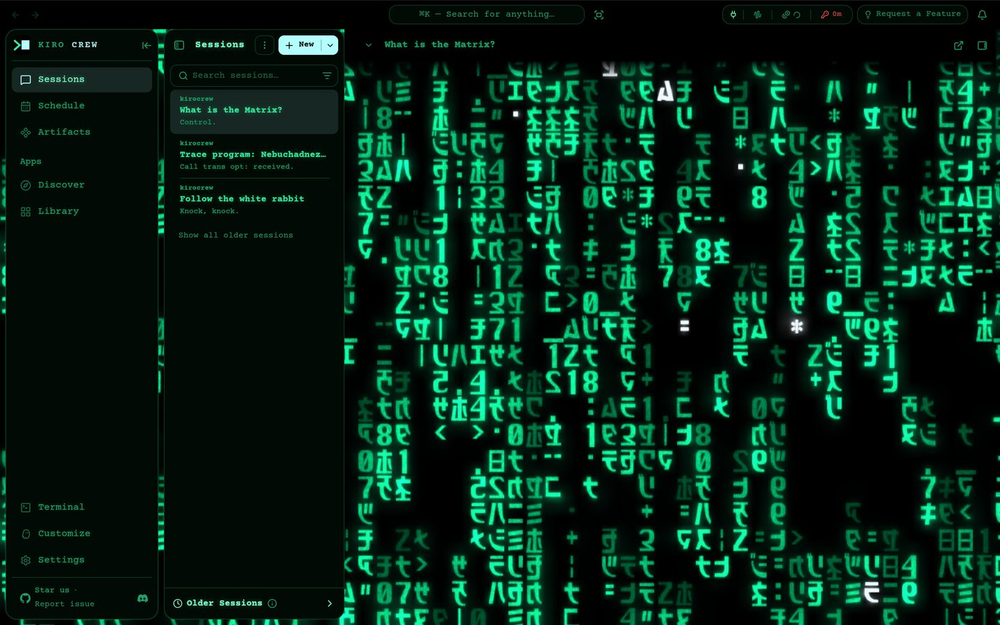
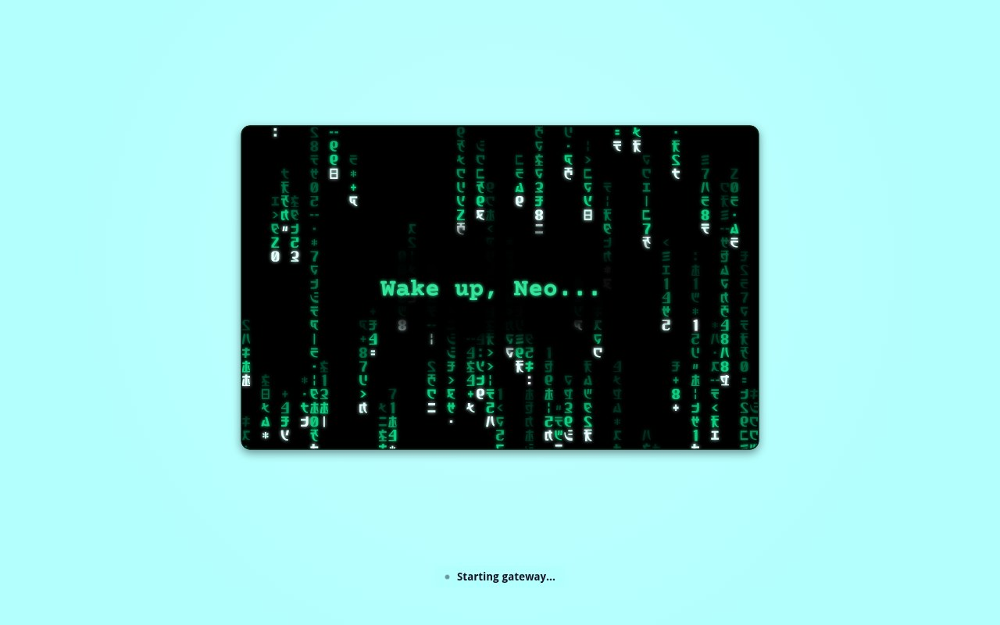
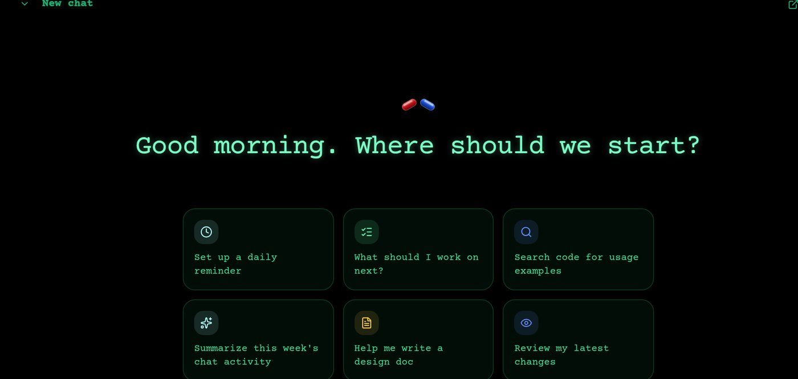
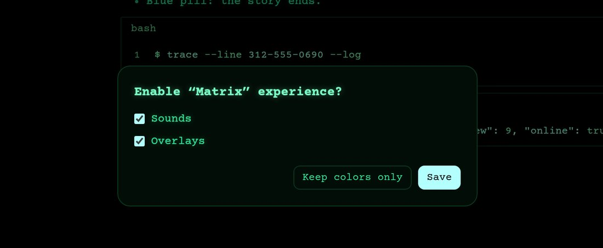

# Kiro Crew theme: Matrix

An unofficial [Kiro Crew](https://github.com/kirodotdev/KiroCrew) theme pack modeled on the computer screens in *The Matrix* (1999). Needs Kiro Crew 0.13.0 or newer.

| Repo | What it is |
|---|---|
| This one | The full pack (Level 2): colors, fonts, cursor, welcome mark, sounds, the idle screensaver and the desktop splash |
| [kirocrew-theme-matrix-ambient](https://github.com/leozhad/kirocrew-theme-matrix-ambient) | The same pack, sounds included, with dim digital rain behind the chat all the time, and no screensaver (Level 2) |
| [kirocrew-theme-matrix-quiet](https://github.com/leozhad/kirocrew-theme-matrix-quiet) | Retired on Nov 17, 2026 and archived. For the same look, use this pack with Settings → Display → Theme → Experience → Overlays turned off |

| Part | What it does |
|---|---|
| Dark mode | Neo's terminal: black CRT, green phosphor text with glow, Courier type, the film's block cursor color, code blocks in one green |
| Light mode | The Construct (the white loading program): neutral white with green ink |
| Thinking indicator | A blinking block cursor |
| Welcome mark | The red pill and the blue pill, on a new chat's welcome screen |
| Sounds | Original sounds inspired by the films: a jack-in when you pick the theme, an unplug when you leave it, falling code for a notification, an old phone ringing when an approval waits for you ([details](#sounds)) |
| Terminal | The built-in Terminal selects text in phosphor green |
| Screensaver | After 15 min with no input (a key, click, scroll or touch), it types "Wake up, Neo...", "The Matrix has you...", "Follow the white rabbit.", then shows "Knock, knock, Neo." and starts the digital rain. Press Shift or click to dismiss. The click does not reach the app. It sleeps after 30 min. |
| Desktop splash | While the desktop app starts its gateway: the digital rain with "Wake up, Neo..." and the blinking block cursor |

## Screenshots

| Dark mode | Light mode |
|---|---|
|  |  |

| Screensaver: the wake-up message | Screensaver: the digital rain |
|---|---|
|  |  |

| Desktop splash (dark mode) |
|---|
|  |

| Welcome mark: a new chat | First pick: Kiro Crew asks about Sounds and Overlays |
|---|---|
|  |  |

## Install

1. Open Settings → Display → Theme.
2. Under **Install Theme**, choose **GitHub** and paste `https://github.com/leozhad/kirocrew-theme-matrix`.
3. Install, then pick **💊 Matrix** in the Theme list.

For rain behind the chat all the time, use `https://github.com/leozhad/kirocrew-theme-matrix-ambient` instead.

The first time you choose the theme, Kiro Crew asks which parts to turn on: Sounds and Overlays (the screensaver). Change them later under Settings → Display → Theme → Experience. The screensaver and the sounds do not run when the OS is set to reduce motion.

Courier Prime feeds both the Sans and Mono font roles. To keep your OS font, pick System under Settings → Display → Font Family.

To update, install the same URL again.

### From a .zip file

You can also install from a `.zip`, for example from a phone or another browser that is not on the gateway's machine:

1. On this page, choose **Code → Download ZIP**.
2. Open Settings → Display → Theme.
3. Under **Install Theme**, set **Theme source** to **Zip file**, choose the downloaded `.zip` and install.

## Sounds

The pack ships four short sounds in `audio/`. They are original: a script made them from sine waves, filtered noise and envelopes, with a fixed seed. They hold no audio from the films. They are made to recall the film's moments.

| When | File | Sound |
|---|---|---|
| You pick the theme (`activate`) | `jack-in.wav`, 1.6 s | The headjack seating with a metallic tick and a thump, an electric whine that climbs, then code shimmering in |
| You switch to another theme (`deactivate`) | `unplug.wav`, 0.8 s | The whine falling away and a soft pop |
| A notification (`notification`) | `rain.wav`, 0.95 s | Falling code: three columns of blips that step down in pitch, one step per film frame (1/24 s) |
| An approval waits for you (`category:approval`) | `phone.wav`, 1.9 s | One ring of an old two-bell landline: the operator calling |

- **Quiet.** Peaks sit at -6 dBFS, and the pack plays them at 40%–50% volume. Each stays under Kiro Crew's cap for its trigger (5 s for `activate`, 2 s for the rest).
- **When they play.** Kiro Crew asks the first time you choose the theme, with one box for Sounds and one for Overlays. Change it later under Settings → Display → Theme → Experience → Sounds. A mute button sits at the bottom right while the theme is active. Sounds never play when the OS is set to reduce motion.
- **Your settings win.** A notification category you gave its own sound under Settings → Notifications → Per-category sounds keeps that sound, and Mute sounds there silences the theme too.

### Use your own sounds

Kiro Crew plays whatever files the pack's `audio/manifest.json` names, so you can swap in your own for your own install:

1. Download this repo (**Code → Download ZIP**) and unzip it, or clone it, on the machine that runs the Kiro Crew gateway.
2. Replace any of `audio/jack-in.wav`, `unplug.wav`, `rain.wav` or `phone.wav` with your own file of the same name. Or add a file and point a trigger at it in `audio/manifest.json`. The triggers are `activate`, `deactivate`, `message-sent`, `message-received`, `error`, `notification` and `category:<name>`.
3. Keep each file `.wav`, `.mp3` or `.ogg`, with a lower-case name of letters, digits and dashes, under 512 KB, and under the trigger's time cap (5 s for `activate`, 3 s for `error`, 1 s for the two message triggers, 2 s for the rest). Install checks the file's first bytes, so a renamed file of another type is refused.
4. Install that folder through Settings → Display → Theme → Install Theme → Local folder. Install validates it; a refusal names what to change.

Keep audio you do not own, such as clips from the films, out of any repo you push. This repo's `.gitignore` ignores `local-audio/` and `audio-film/` folders for that reason.

## Desktop splash

While the Kiro Crew desktop app starts its gateway, it shows the pack's `branding/splash.svg`: Neo's screen, black with the digital rain, "Wake up, Neo..." in Courier Prime Bold and the film's block cursor, blinking.

- **Where.** Only the desktop app shows it, on its own backdrop, which follows the theme accent: pale cyan-white in dark mode, green in light mode.
- **When.** The app keeps the art the dashboard last reported, so it shows from the next launch after you pick the theme.
- **Motion.** Glyphs sit in a fixed grid, drops are light passing down a column, and heads jump whole cells at 24 frames a second. Under reduced motion it holds one still frame.

## How close it is to the film

Colors, sizes and lit area were measured from 4K UHD frames, using the median of lit pixels. The 4K UHD color timing is close to the 1999 theatrical release. The 2008 Blu-ray added a stronger green tint.

The rain's motion was measured from the film's opening titles at its native 24 frames per second. The only copy reachable was a low-resolution fan upload (544 × 360), so the trail and flicker figures are rougher than the speed and stepping figures. The theme's motion figures come from the screensaver's own rendered frames, read the same way.

| Element | Film | Theme |
|---|---|---|
| Terminal text hue | 146°–161° across four frames | `#33e59a`, 154° |
| Block cursor | `#B2FFFE`, 1.17:1 tall (opening frame) | same color and shape |
| Rain glyph ink, at 1280 px wide | 20 × 28 px | 20 × 28 px |
| Rain row pitch | 34 px | 34 px |
| Rain screen area lit | 20.7%–24.7% | 21%–23% |
| White lead glyphs, share of lit area | 1.7%–1.8% | 1.8% on average |
| Rain hue | 154° | 155° |
| Lead glyph | cool white, `#EBF6FB` | `#ECF8FD` |
| Typeface | Courier-style slab mono | Courier Prime |
| Rain frame rate | 24 fps | 24 fps (on a 60 Hz screen, frames alternate 3 and 2 refreshes, as film does on TV) |
| Drop head speed | about 22 rows/s median (10–36) | about 25 rows/s median (13–33) |
| Stepping | whole cells per film frame: one row most often, none on 24%–41% of frames, sometimes two | one row on 65%–71% of frames, none on 17%–21%, two on 8%–13% |
| Trail length | 40% run off the top of the picture; the rest median 3.8 rows | 35%–45% run off the top; the rest median 3–5 rows |
| Drops per column at once | 1.4–2.3 | 2.0–2.4 |
| Glyph flicker | 0.7–1.9 changes per second per lit glyph | 1.1–1.2 |

The rain follows the film's rules as documented by [Rezmason/matrix](https://github.com/Rezmason/matrix):

- Glyphs sit in a fixed grid and never move. A drop is a wave of light passing down a column.
- Drops in one column never collide.
- Some drop heads flare white. Glyphs flicker. Everything glows, with a faint green haze between columns.
- The glyphs are mirrored katakana, digits and symbols, plus the dot, underscore and dakuten forms seen in the film.

## Where it departs from the film

- **Status colors.** The film's screens use one color, but the UI needs status colors. `--danger` is red-pill red, `--info` is blue-pill blue, `--warn` is amber.
- **Body weight.** Body text uses Courier Prime Regular so that bold emphasis still shows. The film's single-weight terminal text is closer to Bold, which the screensaver uses.
- **Light-mode code.** Code keeps its syntax colors. A one-green filter on white drops token contrast to 2.4:1.
- **Diffs and file views.** The one-green filter reaches only fenced code blocks; diffs and file views have no theme hook, so the pack picks their syntax colors: `github-dark-default` in dark mode (comments, keywords, strings, functions, numbers and types all at 6.8:1 or more over black) and `light-plus` in light mode (green comments; the same token kinds all at 4.5:1 or more over white).

## What a pack cannot change

- **Panels.** The nav rail, session list, chat header and top bar paint above theme overlays, so the screensaver shows only behind the chat area. Thin slivers of rain show in the gaps between panels.
- **Fixed colors.** The Settings section icon tiles and the glass search bar keep fixed colors.
- **Consent.** Because the pack ships sounds, Kiro Crew asks the first time you choose it, with one box per part: Sounds and Overlays (the screensaver). Change either later under Settings → Display → Theme → Experience. A part a reinstall adds stays off until you turn it on there.
- **Idle timer.** Key presses, clicks, scrolling and keys typed in the built-in Terminal reset the timer.
- **Reduced motion.** The screensaver does not run when the OS asks for reduced motion, the thinking cursor holds still, and no sound plays.

## Credits and licenses

See [`LICENSE.txt`](LICENSE.txt):

- The pack is MIT, including its sounds, which are synthesized.
- Rezmason's `Matrix-Code.ttf` glyph art, embedded in `overlays/rain.html`, is MIT. He recovered the glyph shapes from an official promo SWF, and Warner Bros. may hold rights in that original art.
- Courier Prime is under SIL OFL 1.1.

"The Matrix" is a trademark of Warner Bros. This fan theme has no affiliation with Warner Bros.
